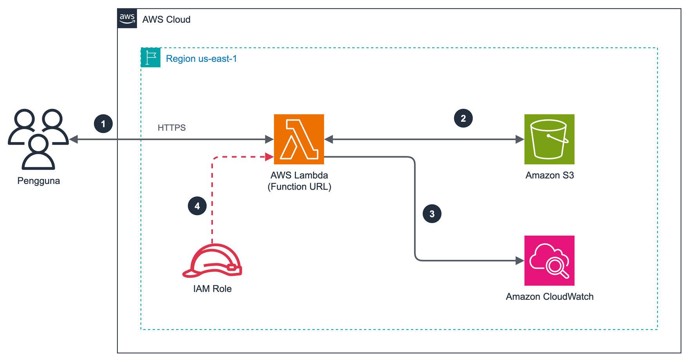

# Ticketing API (Serverless)

Tugas Design & AWS Setup - Cloud Computing

Nama: Nabil Aufa Danaputra
NIM: 24/535223/TK/59357
Track: C (Serverless)

## Deskripsi

REST API untuk sistem tiket helpdesk IT. Pengguna bisa membuat tiket laporan masalah, melihat daftar tiket, mengubah status tiket (`open`, `in_progress`, `closed`), dan menghapus tiket.

Layanan yang digunakan:

- AWS Lambda (Python 3.12)
- Lambda Function URL sebagai endpoint HTTPS
- Amazon S3 untuk menyimpan data tiket
- Amazon CloudWatch Logs

Karena sandbox AWS Academy tidak menyediakan API Gateway dan DynamoDB, API Gateway diganti dengan Lambda Function URL dan DynamoDB diganti dengan S3.

## Arsitektur



## Entitas: Ticket

| Field         | Tipe   | Keterangan                                |
|---------------|--------|-------------------------------------------|
| `ticketId`    | String | UUID, dibuat otomatis                     |
| `title`       | String | Wajib diisi                               |
| `description` | String | Opsional                                  |
| `priority`    | String | `low`, `medium`, `high`                   |
| `status`      | String | `open`, `in_progress`, `closed`           |
| `reporter`    | String | Nama pelapor                              |
| `createdAt`   | String | Waktu dibuat                              |
| `updatedAt`   | String | Waktu terakhir diubah                     |

## Endpoint

| Method | Path            | Fungsi                |
|--------|-----------------|-----------------------|
| POST   | `/tickets`      | Membuat tiket         |
| GET    | `/tickets`      | Menampilkan semua     |
| GET    | `/tickets/{id}` | Menampilkan satu tiket|
| PUT    | `/tickets/{id}` | Mengubah tiket        |
| DELETE | `/tickets/{id}` | Menghapus tiket       |

## Struktur

```
src/lambda_function.py   kode Lambda
tests/                   unit test dan test event
scripts/test_api.sh      pengujian endpoint dengan curl
docs/                    diagram, deployment plan, screenshot
```

## Menjalankan

Test lokal:

```bash
python3 -m unittest discover -s tests -v
```

Deploy ke AWS: lihat [docs/DEPLOYMENT_PLAN.md](docs/DEPLOYMENT_PLAN.md).

Pengujian endpoint setelah deploy:

```bash
./scripts/test_api.sh <function-url>
```
